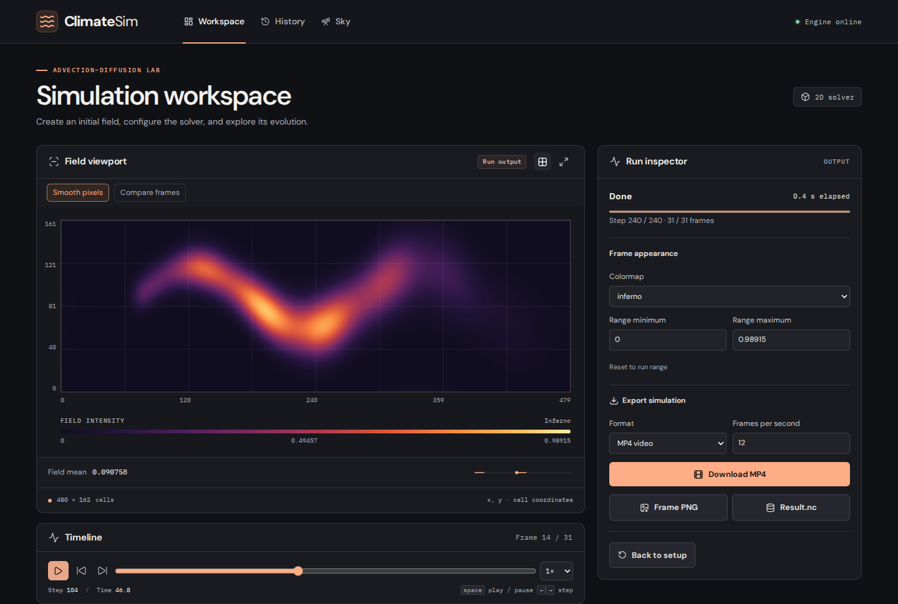
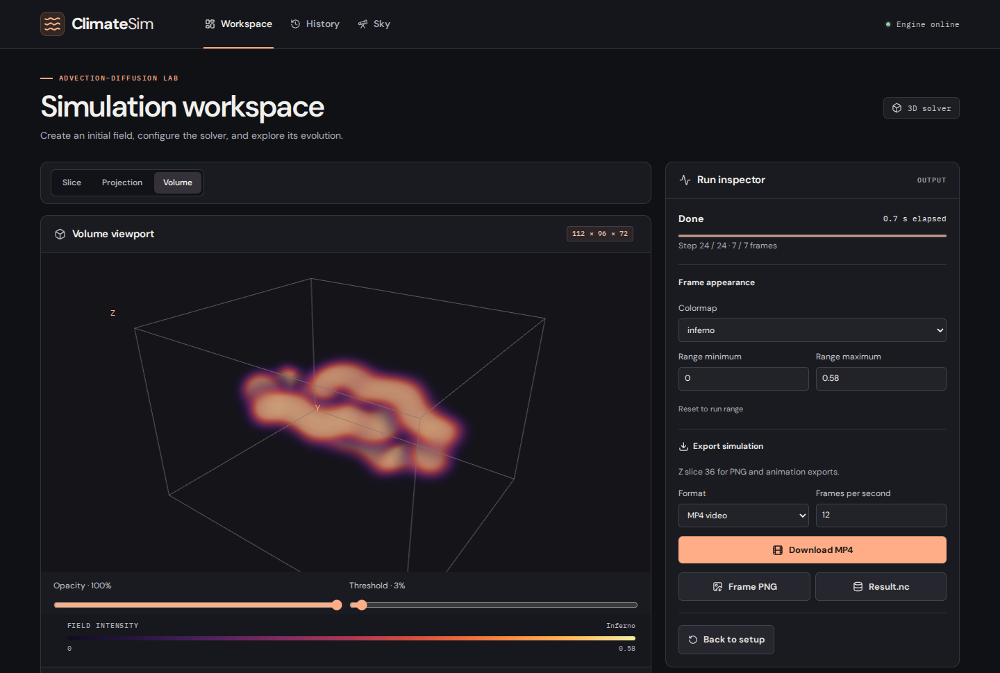
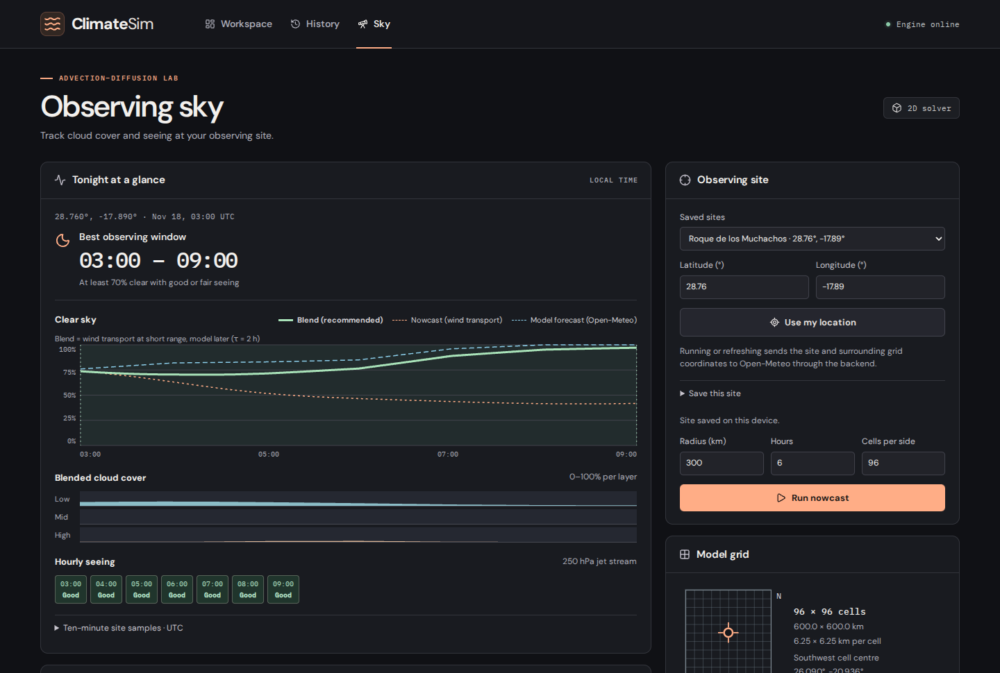
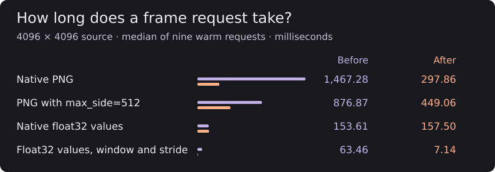

# 

**Draw the starting field, set the wind, and watch a real MPI simulation advance in the browser.**

[](https://github.com/antoniorizzoeng/climate-sim-frontend/actions/workflows/ci.yml)
[](https://github.com/antoniorizzoeng/climate-sim-frontend/actions/workflows/codeql.yml)
[](LICENSE)

[Live demo](https://antoniorizzoeng.github.io/climate-sim-frontend/) · Try mock simulations and Sky nowcasts entirely in your browser without the MPI engine or live weather data. Optional maps use your own MapTiler key.

<p align="center">
  
  <br/>
  <em>Crosswind plume · 480 × 162 cells · 31 saved frames · inferno</em>
</p>

## Why

A painted plume makes the direction of the wind visible before a single number changes on a chart. Scrubbing back to the first frame lets you see which details moved, which softened, and which crossed an edge.

| Shape the experiment                                                                                                                                            | Read the result                                                                                                                               |
| --------------------------------------------------------------------------------------------------------------------------------------------------------------- | --------------------------------------------------------------------------------------------------------------------------------------------- |
| **Draw or upload** · Paint a field, extrude it into layers, or select a variable and level from NetCDF. Examples include twin hotspots and a wrap-around world. | **Play and compare** · Follow written frames, compare against the initial field on one scale, hover for cell values and track the field mean. |
| **Set conditions** · Adjust diffusion, velocity, spacing and boundaries. The editor shows the joint timestep limit before submission.                           | **Keep the run** · Export PNG, GIF, MP4 or NetCDF. History reopens fields and completed runs.                                                 |

## Quick start

With Docker Compose installed and ports 3000 and 8000 free, run this from the checkout. The first build downloads the backend and compiles the MPI solver.

```sh
docker compose up --build
```

Open the workspace, choose **Crosswind plume**, then **Run simulation**. Use **Space** to pause and the arrow keys to step. Turn on **Compare frames** to keep the starting field beside the current one. [Open the local workspace](http://localhost:3000)

<details>
<summary><strong>Connect a development frontend to an existing engine</strong></summary>

Use Node.js 22.22.2 or later in the 22.x line. The API on port 8000 must allow the browser origin `http://localhost:3100` in `CORS_ORIGINS`.

```sh
npm ci
NEXT_PUBLIC_API_URL=http://localhost:8000 npx next dev -p 3100
```

Open the local development server and look for **Engine online** in the header. Compose binds both services to loopback and keeps simulation data in its named volume. [Development workspace](http://localhost:3100) · [Compose configuration](docker-compose.yml)

</details>

## Inside the workspace



| Component                                                                       | What to look for                                                                                                                                                                    |
| ------------------------------------------------------------------------------- | ----------------------------------------------------------------------------------------------------------------------------------------------------------------------------------- |
| [Drawing](src/components/Drawing.tsx) and [Upload](src/components/Upload.tsx)   | Row zero is at the bottom. Loading a large plane into the canvas samples it. Running the upload directly preserves the original grid.                                               |
| [Conditions](src/components/Conditions.tsx)                                     | Opposite periodic faces are paired. The server validates the request before it joins the queue.                                                                                     |
| [Player](src/components/Player.tsx) and [Timeline](src/components/Timeline.tsx) | Upcoming frames are decoded ahead of playback. The scrubber grows as snapshots arrive, and the sparkline uses the means of loaded grids.                                            |
| [Output](src/components/Output.tsx) and [History](src/components/History.tsx)   | Revisit a run, change the display range or export the current view. Run outputs last seven days. Inputs archive after seven days without use and remain recoverable for another 30. |

### See inside a volume



Open a volume to start at its middle z slice. **Slice** follows one layer along x, y or z. **Projection** takes a maximum or mean through a column. **Volume** ray-marches the scalar field in WebGL2. Drag to orbit, then adjust the opacity and threshold to inspect a weaker structure behind a stronger one. PNG and movie exports use the last selected slice or projection. [Volume player](src/components/VolumePlayer.tsx)

## Sky nowcast



Enter an observing site to compare three wind-transported cloud layers with Open-Meteo's model forecast. The blend begins with transport and shifts toward the model as lead time grows. With the default two-hour time constant, the transport share falls to about 37% after two hours. Play the three layer movies together to see which clouds are moving toward the site.

The best window is the longest run of samples with at least 70% blended clear sky and good or fair seeing. Seeing is estimated from 250 hPa wind. Local turbulence, cloud formation and dissipation, vertical motion and weather outside the grid limit the forecast. The screenshot shows a completed forecast for **Roque de los Muchachos**.

Saved site names stay in the browser. Only location coordinates for the site and surrounding grid travel to Open-Meteo with the requested weather variables and UTC hours. [Sky components](src/components/sky) · [Backend method](https://github.com/antoniorizzoeng/climate-sim-backend#sky-nowcast)

## Playback performance

The player samples display planes wider or taller than 512 cells and fetches an exact cell on hover. **Frame PNG** keeps the native plane resolution. For a 4096² source, the backend benchmark measured **7.14 ms** for a strided 1024² window of values and **157.50 ms** for the complete float32 plane.



These are warm, in-process API timings on one logical CPU. Browser frame rate also depends on network transfer, decoding and the graphics device. [Measurements and method](https://github.com/antoniorizzoeng/climate-sim-backend/blob/main/docs/performance.md)

<details>
<summary><strong>Configuration and contract</strong></summary>

| Setting                  | Meaning                                                                                                             |
| ------------------------ | ------------------------------------------------------------------------------------------------------------------- |
| `NEXT_PUBLIC_API_URL`    | API origin used by the browser. Defaults to `http://localhost:8000`. Set at build time for the standalone frontend. |
| `NEXT_PUBLIC_MOCK_API`   | Set to `1` for the in-memory browser demo on localhost or HTTPS. Reloading clears its runs.                         |
| `CORS_ORIGINS` (backend) | Include the frontend's origin so it can read the binary grid responses and their dimension headers.                 |

[OpenAPI contract](api/openapi.yaml) · [Generated client types](src/lib/schema.ts) · [Example fields and conditions](src/lib/examples.ts)

</details>

## Project family

[MPI engine](https://github.com/antoniorizzoeng/climate-sim-mpi-cpp) · [Simulation API](https://github.com/antoniorizzoeng/climate-sim-backend) · **Browser workspace** (here)

## Contributing

Include the input field, run settings and browser when reporting a playback issue. Component and Playwright tests share the browser mock. [Contributing guide](CONTRIBUTING.md)

## License

[GNU Affero General Public License v3.0](LICENSE)
